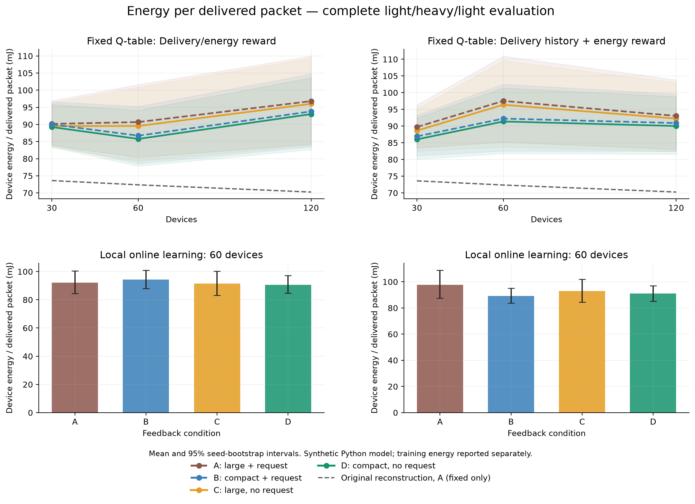

# LoRaWAN Resource Allocation and Feedback Evaluation

Reproducible experiments on spreading-factor and transmit-power allocation with delayed, lossy and costed learning feedback.

This repository contains the simulator, policy implementations, complete experimental records, source and model fingerprints, tests, figures and interpretation. It separates improvements in allocation from reductions in the communication needed to learn.

**Evidence boundary:** these are synthetic Python/NumPy experiments, not ns-3 or hardware measurements. DSF2R is reconstructed from the paper with declared assumptions. Other literature-inspired comparators are labelled as adaptations. This repository does not claim universal superiority or that all LoRaWAN research gaps have been resolved.

## Research question

Can explicit delivery information and an energy-aware reward improve the delivery–energy trade-off of SF–power allocation, and can compact feedback reduce its communication cost?

The proposed allocator observes the latest reported SNR state, current power and recent resolved delivery outcomes. It chooses one of 30 SF–power pairs and uses

$$
r_t=y_t-0.2E_t/E_{\mathrm{ref}},\qquad E_{\mathrm{ref}}=0.36383221248\ \mathrm{J}.
$$

The delivery flag `y_t` arrives only through a successfully received report. Missing reports leave outcomes unknown. The compact protocol returns individual receipt bits and the latest SNR-state bin instead of historical SNR samples and redundant identifiers. The unchanged Q-learning update uses alpha=0.1 and gamma=0.9.

## Established controlled result

The preserved feedback study uses 30 paired evaluation seeds, 30/60/120 devices, three traffic phases, identical initial tables across feedback conditions and a separate local-online confirmation. It contains 1,320 evaluations and 1,530 training episodes.

For the combined learner at 60 devices with its Q-table fixed during evaluation:

| Metric | Large reports + requests | Compact reports, request-free |
|---|---:|---:|
| Device energy per delivered application packet | 97.52 mJ | 91.37 mJ |
| Total gateway downlink airtime | 345.49 s | 274.37 s |
| Generated application packets delivered | 71.04% | 70.91% |

The mean energy reduction is **6.31%** and the total downlink-airtime reduction is **20.59%**, within the same learner. The paired energy difference is −6.15 mJ/delivery, with a 95% bootstrap interval of [−9.73, −2.92]. Application delivery changes by −0.13 percentage points [−1.03, +0.78]; equal reliability is not established. Online energy intervals span zero.

With the same large-report protocol, the combined allocation extension delivers more generated packets than the original reconstruction but consumes more energy per delivery. Thus the allocation result is a trade-off, and the feedback result reduces part of its cost. [Complete controlled results](experiments/feedback/results/RESULTS.md) · [Evidence and claim boundaries](docs/evidence_scope.md).



## Experimental organization

| Study | Purpose | Location |
|---|---|---|
| Controlled feedback study | Factorial compression/request ablation, common frozen tables, protocol-matched online confirmation | [experiments/feedback](experiments/feedback/README.md) |
| Scenario robustness study | Four state/reward variants and a fixed-radio control across load, propagation and feedback-loss cases | [experiments/robustness](experiments/robustness/README.md) |
| Online bandit comparison | Matched-action Thompson sampling versus energy-reward Q-learning under the same delayed reports | [experiments/baselines](experiments/baselines/README.md) |
| Initial allocation study | Preserved original Python code, earlier measurements and MIX-MAB adaptation | [archive/initial_pilot](archive/initial_pilot/README.md) |
| Feedback format and airtime tools | Standalone codec and analytical calculations | [tools/feedback_design](tools/feedback_design/README.md) |

The scenario matrix includes stable low load, stable high load, a load step, a 6 dB channel step, 30% feedback erasure and 100% feedback erasure. All planned cases are reported, including failure cases. A declared finite matrix is not a test of every possible real network.

The three current studies contain **12,120 executed evaluations and 3,150 training episodes**, with 30 paired seeds per comparison and **11 figures in PNG/SVG**. Overlapping cases/seeds are deliberately reused and are not counted as additional independent statistical samples. The combined frozen learner's feedback comparison reduces downlink airtime in all 18 case/density cells and has energy intervals below zero in 15 cells; some delivery penalties remain. See the [research results](docs/results.md) and [figure guide](docs/figures.md).

The added online comparison is also a counterexample to a universal Q-learning advantage: at 60 devices under the load-step case and protocol D, Thompson delivers 88.36% of generated packets versus 71.04% for the combined Q learner. The paired Q−Thompson delivery difference is −17.32 percentage points [−19.49,−15.12]; its energy difference is inconclusive. Under the channel step, Thompson also uses less energy per delivery. [Full online comparison](experiments/baselines/results/RESULTS.md) retains all cases and both protocols. This limitation is part of the result, not removed from the plots.

## Run

The recorded environment uses Python 3.14, NumPy 2.3.5 and Matplotlib 3.11.2. From the repository root:

```shell
python -m venv .venv
```

Activate the environment, then install the recorded dependencies:

```shell
python -m pip install -r requirements-lock.txt
python validate.py --quick
```

The quick validation runs mechanism and data-contract checks plus small all-case simulations. These smoke runs are not substitutes for the archived thirty-seed results. [Reproduction instructions](docs/reproducibility.md) list full simulation and figure-regeneration commands.

## Read the results correctly

- Application delivery is `received/generated`; PDR per attempt is `received/attempted`. Both are provided so duty-related admission drops remain visible.
- Energy includes modeled device TX, RX and sleep. Training radio expenditure is separate. Processing, gateway electrical energy and backhaul energy are excluded.
- Confidence intervals resample independent paired seeds, not packets. The full per-seed results and all four feedback settings remain available.
- Frozen Q-tables still choose different radio settings as observed state changes. Online comparisons also include protocol-matched training and evaluation exploration.
- Report airtime, report count, unresolved labels and outcome-report delay are measured separately. A shorter report can enable more reports, so per-report savings differ from total network savings.

See [methodology](docs/methodology.md), [related work](docs/related_work.md), [validation protocol](docs/validation_protocol.md) and [limitations](docs/limitations.md) before interpreting the figures as evidence about published methods or physical deployments.

The [figure guide](docs/figures.md) explains every graph, its controls, units and interpretation. The [source-provenance record](docs/source_provenance.md) distinguishes the project implementation, inspected third-party code and retained historical evidence.

## Attribution and reuse

Author: Keshav Sarda. Software citation metadata is in [CITATION.cff](CITATION.cff). Original research and implementation sources are credited in the literature comparison and source comments. No open-source license has been selected; this repository is private research material. Dependencies retain their respective licenses.
